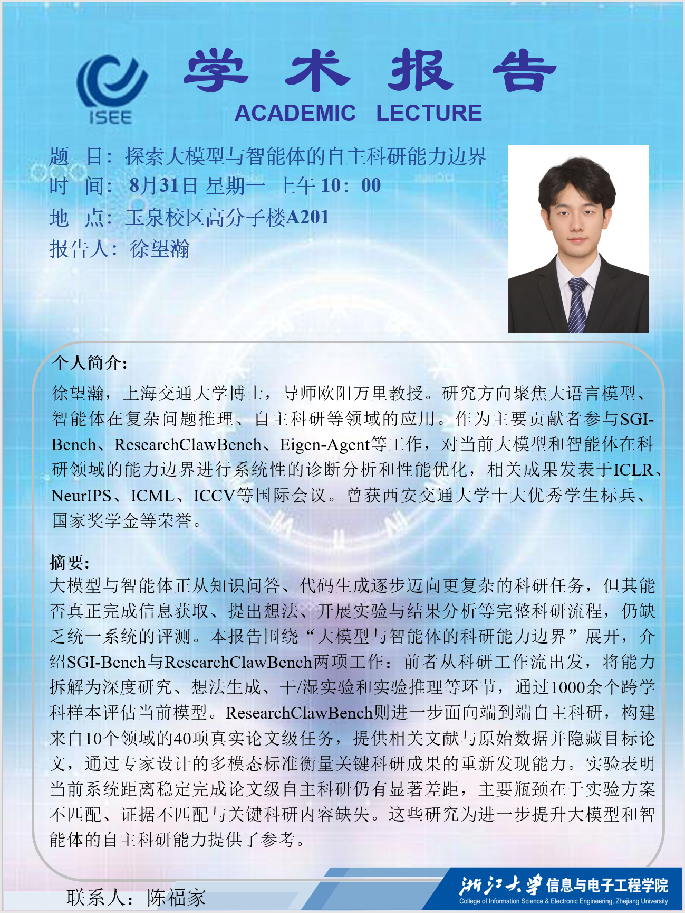
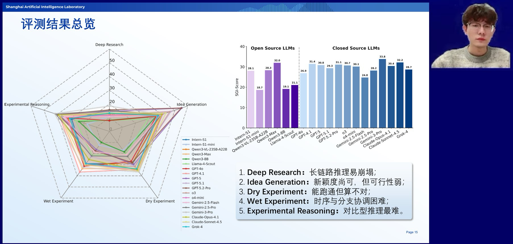
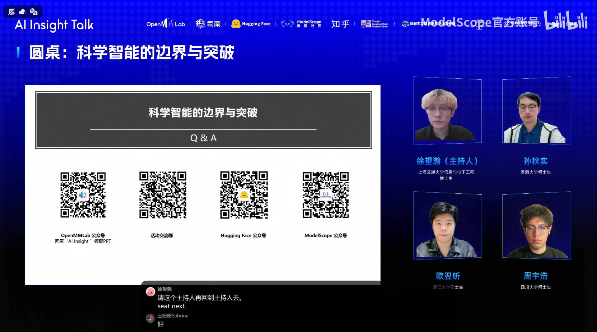

# <i class="fas fa-microphone-alt section-icon"></i> Invited Talks

  

    

      <button class="talk-video-trigger" type="button" data-video-src="{{ '/videos/cctv-13-rsi-interview.mp4' | relative_url }}" data-video-poster="{{ '/images/cctv-13-rsi-interview.jpg' | relative_url }}" data-video-title="How Do Large AI Models Achieve Recursive Self-Improvement (RSI)?" aria-label="Play the CCTV 13 interview" aria-haspopup="dialog">
        
        <i class="fas fa-play"></i>
      </button>
    

  

  

<a class=PaperTitle href="https://tv.cctv.com/2026/11/04/VIDE4oxNZ2qi1xmzRdxa7k8B261104.shtml?spm=C28340.PxtGka5hyWPX.EORBCjGqZgig.31"><b>How Do Large AI Models Achieve Recursive Self-Improvement (RSI)?</b></a> \\
*CCTV 13, 2026* \\
Tao Gui, **Wanghan Xu** \\
[<a href="https://tv.cctv.com/2026/11/04/VIDE4oxNZ2qi1xmzRdxa7k8B261104.shtml?spm=C28340.PxtGka5hyWPX.EORBCjGqZgig.31">CCTV 13</a>]

  

  

    

      <!-- 

 -->
      
    

  

  

<b>Exploring the Boundaries of Autonomous Scientific Research Capabilities in Large Language Models and Agents</b> \\
*Zhejiang University, 2026* \\
**Wanghan Xu**

  

  

    

      <!-- 

 -->
      
    

  

  

<a class=PaperTitle href="https://www.bilibili.com/video/BV16yqdBnE82/?share_source=copy_web&vd_source=7b9d898a8c3bbebf65c411956ed7f8ce"><b>Large Language Model Evaluation Technology</b></a> \\
*OpenMMLab & 知乎 & ModelScope, 2025* \\
**Wanghan Xu**, Fengjiao Chen, Zhongpeng Ji, Tianshi Zheng \\
[<a href="https://www.bilibili.com/video/BV16yqdBnE82/?share_source=copy_web&vd_source=7b9d898a8c3bbebf65c411956ed7f8ce">BiliBili</a>] [<a href="https://mp.weixin.qq.com/s/y6kA7up82qwf0c2nq_h-Xw">OpenMMLab</a>] [[Slides](/pdfs/SGI-Bench.pdf)]

  

  

    

      <!-- 

 -->
      
    

  

  

<a class=PaperTitle href="https://www.bilibili.com/video/BV1gb8kzbEJA/?share_source=copy_web&vd_source=7b9d898a8c3bbebf65c411956ed7f8ce"><b>AI Scientific Discovery</b></a> \\
*HuggingFace & 知乎 & ModelScope, 2025* \\
**Wanghan Xu**, Qiushi Sun, Yixin Ou, Yuhao Zhou \\
[<a href="https://www.bilibili.com/video/BV1gb8kzbEJA/?share_source=copy_web&vd_source=7b9d898a8c3bbebf65c411956ed7f8ce">BiliBili</a>]

  

